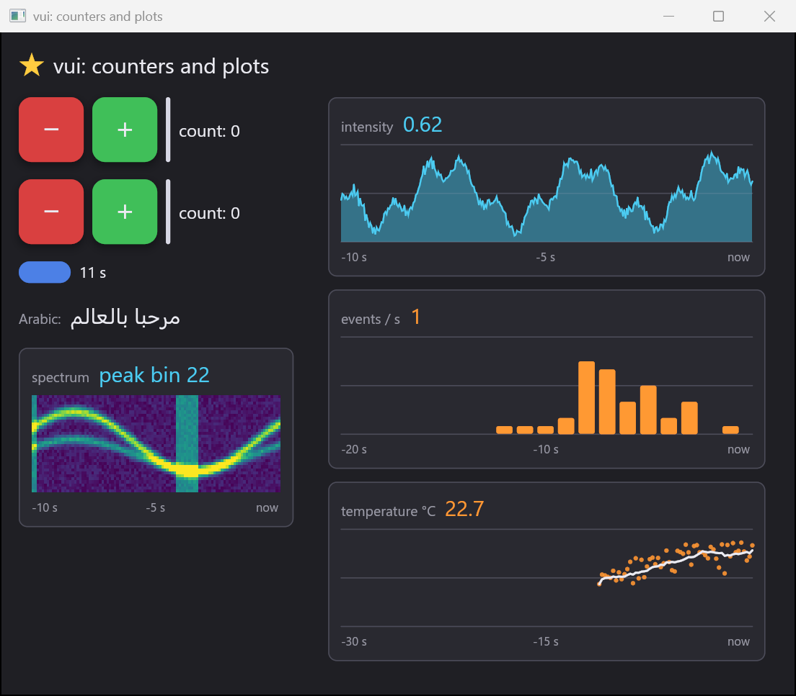
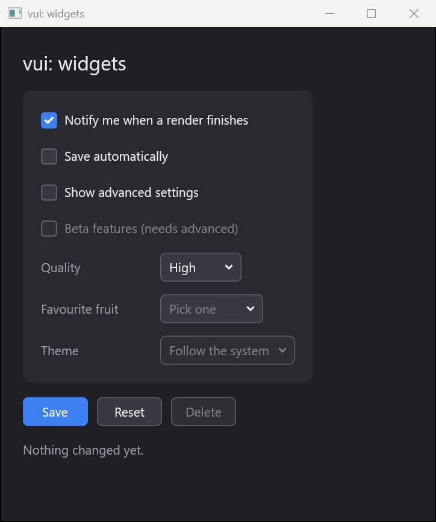
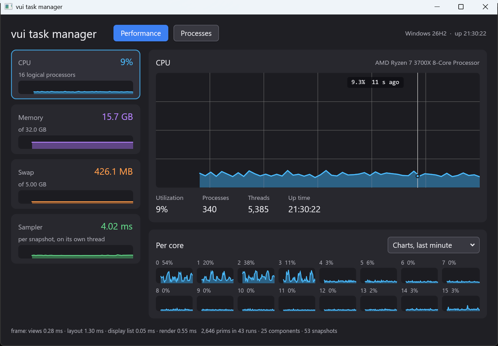
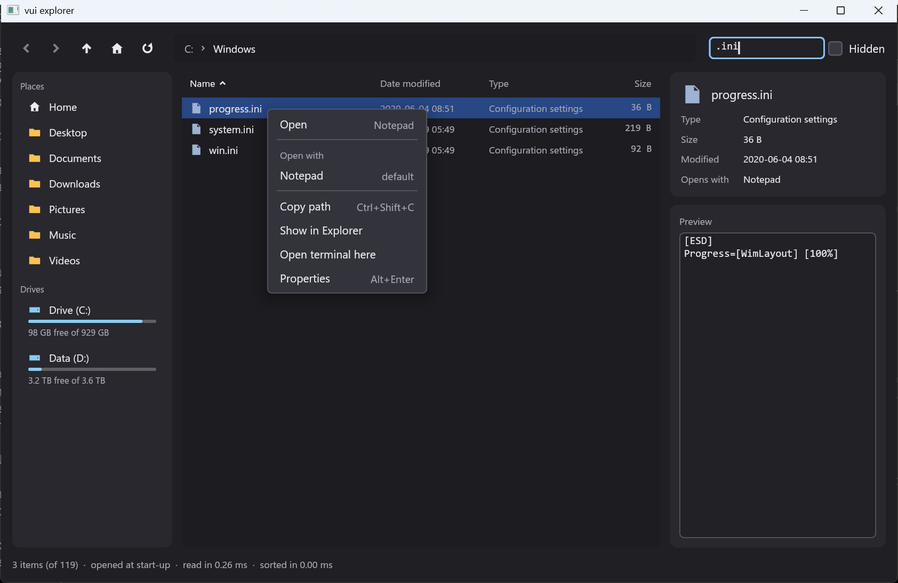
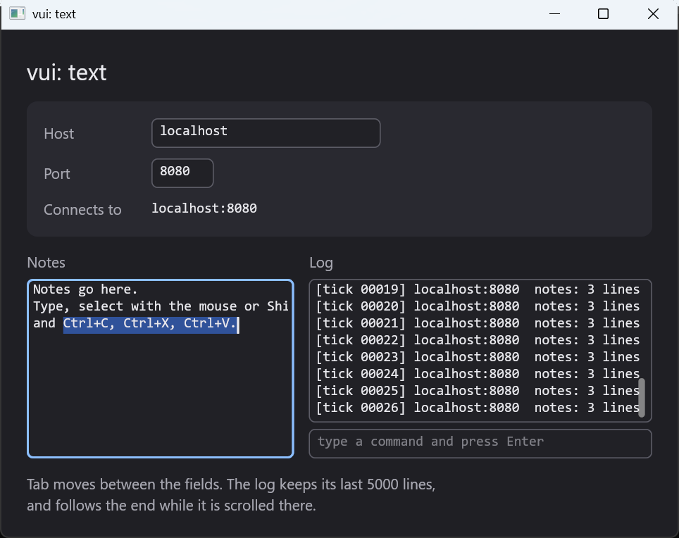

<p align="center">
  <picture>
    <source media="(prefers-color-scheme: dark)" srcset="docs/logo-dark.svg">
    
  </picture>
</p>

<p align="center">
  <strong>Windows, input and a declarative UI toolkit for C++ coroutines,<br>on the same event loop as your sockets, timers and files.</strong>
</p>

<p align="center">
  <a href="https://github.com/jorgen/vui/actions/workflows/ci.yml"></a>
  <a href="https://github.com/jorgen/vui/releases/tag/latest"></a>
  <a href="https://jorgen.github.io/vui/"></a>
  
  
  <a href="LICENSE"></a>
</p>

---

Most GUI toolkits own the program: they run their own loop, and everything else (the network, the
disk, the timers) has to be pushed through it from another thread. vui doesn't. It runs on
[vio](https://github.com/jorgen/vio), so a window is just another thing you `co_await`, next to a
socket read:

```cpp
while (auto frame = co_await window.frame())
  draw(*frame);
```

One thread and one loop. Window events wake the same `vio::event_loop_t` as I/O does, so there is
no second loop to hand work across and nothing to lock.

<p align="center">
  
  &nbsp;
  
</p>
<p align="center">
  
</p>
<p align="center">
  
</p>
<p align="center">
  
</p>

## Try the demos

**In the browser:** [jorgen.github.io/vui](https://jorgen.github.io/vui/) runs the counters, widgets,
cells and 200,000-chip demos, built with Emscripten and drawn through WebGPU. It needs a browser with
WebGPU, such as a current Chrome or Edge.

**Native:** the task manager and the explorer, built from the latest commit on master. Each is one
executable that needs nothing installed:

| | |
| --- | --- |
| **Windows** (x64) | [vui-demos-windows-x64.zip](https://github.com/jorgen/vui/releases/download/latest/vui-demos-windows-x64.zip) |
| **macOS** (Apple silicon) | [vui-demos-macos-arm64.tar.gz](https://github.com/jorgen/vui/releases/download/latest/vui-demos-macos-arm64.tar.gz) |
| **Linux** (x64; X11 or Wayland) | [vui-demos-linux-x64.tar.gz](https://github.com/jorgen/vui/releases/download/latest/vui-demos-linux-x64.tar.gz) |

They are not signed, so Windows and macOS may ask before running one the first time (on macOS,
allow it under System Settings, Privacy & Security). Every build is on the [latest release](https://github.com/jorgen/vui/releases/tag/latest).

## What's inside

**A window layer** (`vui::vui`)

- Native backends for **X11, Wayland, Win32 and Cocoa**, behind one interface: title, size,
  position, fullscreen, minimise and maximise, cursor, clipboard (and the primary selection on X11
  and Wayland) and content scale.
- **Everything is awaited**: a frame to draw, input, a resize, a close request. Input arrives
  through typed subscriptions, such as `window.subscribe<key_event_t, text_event_t>()`. Each
  subscription has its own queue, so every subscriber sees every event of its types, and every
  await yields `std::nullopt` once the window closes.
- **Graphics without linking graphics**: you get GL contexts (EGL, WGL, NSOpenGL), Vulkan surfaces,
  a `CAMetalLayer` and a Direct3D 12 swap chain. You also get the device handles OpenCL and CUDA
  need to share with them. GL, EGL and Vulkan are loaded at run time, so a program that never asks
  for one doesn't need it installed.
- **Frame pacing that matches the display**, including Wayland's rule of one frame per commit, and
  Win32 and Cocoa modal resize loops that keep the rest of the loop running.

**A declarative toolkit** (`vui::ui`)

- A component is **one struct**: its state, a `const` `view()` that describes it, and a `behave()`
  coroutine that reacts to events. There are no hooks, no stale closures and no dependency arrays,
  because only the stateless half ever re-runs.
- Text is shaped by **HarfBuzz** and rasterized by **FreeType**. It covers Latin, Devanagari and
  Arabic, and lays out the same at every scale.
- Rendering uses **Vulkan**, with GL as the fallback. It works from a display list with dirty
  propagation and cached layout, so unchanged parts are not drawn again. The shaders are written
  in Slang, and the SPIR-V is committed.
- A canvas for what has too many pieces for a node each, such as a terminal's cells: rectangles on
  whole pixels and glyphs by code point, with bold and italic faces, five underline styles and
  fallback fonts and colour emoji, converted once and kept while unchanged.
- Rows, columns and flex layout, clipping, popups, focus and keyboard navigation, icons from
  paths, images, plus a set of widgets: buttons, checkboxes, comboboxes, labels, line edits, and a
  fixed-width text edit that serves as an input pane or as a scrolling log.

## A taste

```cpp
#include <vui/vui.h>
#include <vui/ui/ui.h>
#include <vio/run.h>

namespace ui = vui::ui;

constexpr ui::color_t red{0.85f, 0.25f, 0.25f, 1};
constexpr ui::color_t dark_red{0.55f, 0.12f, 0.12f, 1};
constexpr ui::color_t green{0.25f, 0.75f, 0.35f, 1};

struct counter_t
{
  int count = 0;
  ui::pressable_t inc, dec;

  ui::node_t view() const
  {
    return ui::row_t{.gap = 8, .children = {
      ui::box_t{.size = {60, 60}, .color = dec.held() ? dark_red : red, .events = dec},
      ui::box_t{.size = {60, 60}, .color = green, .events = inc},
      ui::text_t{.text = "count: " + std::to_string(count), .size = 16},
    }};
  }

  ui::behaviour_t behave(ui::scope_t &)
  {
    auto presses = ui::subscribe<ui::press_event_t>(inc, dec);
    while (auto press = co_await presses)
      count += press->source == &inc ? 1 : -1;
  }
};

int main()
{
  return vio::run([](vio::event_loop_t &loop) -> vio::task_t<int> {
    auto display = vui::display_t::open(loop);
    if (!display)
      co_return 1;
    auto window = vui::window_t::create(*display, {.title = "counter", .size = {480, 200}});
    if (!window)
      co_return 1;
    auto closing = [](vui::window_t &window) -> vio::task_t<void> {
      auto requests = window.subscribe<vui::close_request_t>();
      co_await requests;
      window.close();
    }(*window);
    co_await ui::run(*window, counter_t{});
    co_await std::move(closing);
    co_return 0;
  });
}
```

A component's `behave()` is an ordinary coroutine on the loop. It can `co_await` a timer, a DNS
lookup or an HTTPS request in the middle of handling a click, and the view rebuilds when it
changes state.

## Building

vui uses CMake 3.30+, a C++23 compiler (MSVC 2022, GCC 14 or Clang 18) and
[cmake-dep](https://github.com/jorgen/cmake-dep). cmake-dep fetches vio, FreeType, HarfBuzz,
Vulkan-Headers and doctest at configure time, so there is nothing to install by hand besides the
platform's own window-system headers.

```bash
cmake -G Ninja -B build -DCMAKE_BUILD_TYPE=Debug
cmake --build build
./build/vui_tests
```

vio builds BoringSSL, which needs **Go** on `PATH`, and **NASM** as well on Windows. On Linux you
also need the X11 and Wayland development packages:

```bash
sudo apt-get install pkg-config libx11-dev libxkbcommon-dev libwayland-dev libwayland-bin wayland-protocols
```

To work on vio and vui together, point the build at your vio checkout:

```bash
cmake -B build -DCMDEP_SOURCE_DIR_VIO=/path/to/vio
```

| Option | Default | |
| --- | --- | --- |
| `VUI_BUILD_TESTS` | `ON` | `vui_tests` |
| `VUI_BUILD_EXAMPLES` | `ON` | everything under `examples/` |
| `VUI_FETCH_SLANG` | `OFF` | fetch a prebuilt `slangc` for the `vui_shaders` target |
| `VUI_USE_SYSTEM_<DEP>` | `OFF` | use an installed copy of a dependency instead of fetching it |

### Standalone demos

The `dist-windows` preset builds the task manager and the explorer as executables that need nothing
but Windows -- the C++ runtime linked in, no console window -- and zips them with the licence:

```bash
cmake --preset dist-windows
cmake --build --preset dist-windows
# build-dist/vui-demos-<version>-Windows-AMD64.zip
```

## Examples

| | |
| --- | --- |
| `vui_hello` | a GL window that reads keys, clicks and resizes from four coroutines |
| `vui_input_echo` | prints every input event a window receives |
| `vui_windows_and_network` | windows opening and closing while the same loop does network I/O |
| `vui_ui_counter` | counters, a clock and four live plots |
| `vui_ui_list` | a list of rows that grows and shrinks |
| `vui_ui_feed` | a UI fed from a socket |
| `vui_ui_chips` | 200,000 chips, the stress test |
| `vui_ui_widgets` | the widget set |
| `vui_ui_text` | labels, line edits, a notes pane and a log fed by a timer |
| `vui_ui_cells` | a terminal's grid of styled cells on one canvas: colours, bold and italic, underline styles, fallback fonts, raw keys and mouse |
| `vui_explorer` | a file explorer: folders that open at once and fill in as they are read, natural sorting, filtering and type-ahead, a context menu with the applications that open the file, delete to the Recycle Bin or for good, a path bar to type or paste into, thumbnails and text previews from the system, configurable places, extract and compress with the archive tools installed, on Windows, Linux and macOS |
| `vui_task_manager` | the advanced one: live CPU, per-core and memory charts, a sortable, filterable process table and an activity log, fed by a sampling thread on Windows, Linux and macOS |
| `vui_vulkan_clear`, `vui_d3d12_clear`, `vui_metal_clear` | bring your own renderer |

Every example takes an optional frame or time limit, and CI uses it to run them unattended.

## Testing

On Windows and macOS, run `vui_tests`. On Linux, `test/run_linux.sh` starts Xvfb and a headless
weston, then runs the tests and the examples on both X11 and Wayland:

```bash
test/run_linux.sh build/vui_tests
```

## Status

vui is young and its API still moves. The window layer runs on all four window systems. The
Vulkan renderer has been run on Windows; Linux and macOS are next. [PLAN.md](PLAN.md) is the design
and the roadmap, and [DECISIONS.md](DECISIONS.md) records every choice made along the way, with its
reason.

## License

MIT. See [LICENSE](LICENSE).
